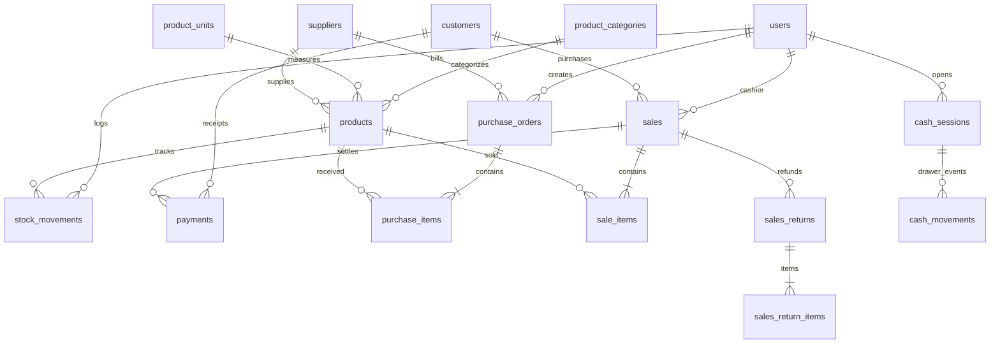

# SKYTHS — Project Architecture Report

## 1. Executive Summary & Technology Stack

SKYTHS is an enterprise-grade, offline-first desktop application engineered for point-of-sale (POS), inventory management, procurement, customer credit accounting, and financial reporting. The system operates autonomously without relying on external cloud dependencies, storing all transactional, customer, and product records in an embedded SQLite database configured for high durability.

### Framework & Package Versions

| Component | Technology | Version | Purpose |
| :--- | :--- | :--- | :--- |
| **Desktop Runtime** | Electron | `^35.0.0` | Native OS windowing, file I/O, IPC security boundary |
| **Frontend Framework** | React | `^19.0.0` | Declarative user interface, concurrent rendering |
| **Language** | TypeScript | `^5.8.2` | Static typing across main, preload, and renderer layers |
| **Build Tool** | Vite | `^6.2.1` / `v6.4.5` | High-speed ESM bundling, HMR, asset compilation |
| **Styling** | Tailwind CSS | `^3.4.17` | Utility-first styling with dual-theme design tokens |
| **State Management** | Zustand | `^5.0.4` | Lightweight global reactive stores (`useAppStore`, `useCartStore`, `useCorbelStore`) |
| **Embedded Database** | better-sqlite3 / node:sqlite | `^13.0.3` / Node 22 | Synchronous C-binding database driver with WAL mode |
| **Password Security** | bcryptjs | `^3.0.3` | Salted password hashing (cost factor 10) |
| **Testing Engine** | Vitest | `^3.0.8` | In-memory unit, integration, and accounting verification |
| **Data Validation** | Zod | `^3.24.2` | Schema parsing and runtime boundary validation |
| **Icons & UI** | Lucide React | `^1.16.0` | Comprehensive vector iconography |

---

## 2. Multi-Tier Application Architecture

The system enforces strict architectural separation of concerns across three core computing tiers:

```
+-------------------------------------------------------------------------+
|                         RENDERER PROCESS (Chromium)                     |
|                                                                         |
|  +--------------------------------+  +-------------------------------+  |
|  |       CORBEL MODERN SHELL      |  |      SKYTHS CLASSIC SHELL     |  |
|  |  (Dashboard, Analytics, Kanban,|  |  (21 Enterprise Admin Views:   |  |
|  |   Orders, Products, Customers) |  |   POS, Inventory, Ledgers)    |  |
|  +--------------------------------+  +-------------------------------+  |
|                  |                                   |                  |
|                  +-----------------+-----------------+                  |
|                                    v                                    |
|                      Zustand Stores & Audio Engine                      |
|                  (useAppStore, useCartStore, audioAlerts)               |
|                                    |                                    |
|                                    v                                    |
|                        window.skythsAPI (Bridge)                        |
+------------------------------------|------------------------------------+
                                     |
                       Electron IPC Channel Barrier
                        (contextIsolation: true)
                                     |
+------------------------------------v------------------------------------+
|                         MAIN PROCESS (Node.js)                          |
|                                                                         |
|  +-------------------------------------------------------------------+  |
|  |                          IPC Handlers                             |  |
|  |  (auth:*, products:*, pos:*, purchases:*, returns:*, reports:*)   |  |
|  +-------------------------------------------------------------------+  |
|                                    |                                    |
|                                    v                                    |
|  +-------------------------------------------------------------------+  |
|  |                      Core Domain Services                         |  |
|  |  AuthService       ProductService     PosService     ReturnService|  |
|  |  PurchaseService   FinancialService   ReportService  BackupService|  |
|  |  BusinessService   AuditService       ConfigService  Assistant    |  |
|  +-------------------------------------------------------------------+  |
|                                    |                                    |
|                                    v                                    |
|  +-------------------------------------------------------------------+  |
|  |                      DBManager & Driver Layer                     |  |
|  |  (SQLiteAdapter: WAL Journal, Foreign Keys ON, Prepared Stmts)    |  |
|  +-------------------------------------------------------------------+  |
+------------------------------------|------------------------------------+
                                     |
                                     v
+-------------------------------------------------------------------------+
|                            FILESYSTEM STORAGE                           |
|       skyths.db (WAL / SHM)  |  skyths_backup_*.db  |  app_config.json  |
+-------------------------------------------------------------------------+
```

### A. Renderer Process (Presentation Tier)
- **Dual Presentation Shells**:
  1. **Corbel Modern Design**: High-fidelity porcelain light mode and obsidian dark mode design system inspired by minimalist retail management consoles, featuring animated cubic count-ups, radial tachometer gauges, SVG sparklines, and Kanban workflow tracking.
  2. **SKYTHS Classic Enterprise POS**: Deep-functionality operational dashboard featuring full POS terminal barcode scanning, cash drawer float tracking, supplier purchase orders with WAC recalculations, customer statement generation, and P&L financial reporting.
- **State Management**:
  - `useAppStore`: Manages authenticated session user, active view, notifications, business settings, and drawer sessions.
  - `useCartStore`: Encapsulates cart items, line discounts, customer selection, payment tender calculations, and change calculation.
  - `useCorbelStore`: Manages Corbel shell navigation, active projects, Kanban cards, and theme switcher (`light` | `dark`).

### B. Preload Process (Secure IPC Boundary)
- Exposes `window.skythsAPI` using Electron's `contextBridge.exposeInMainWorld()`.
- Guarantees `contextIsolation: true` and `nodeIntegration: false` in the renderer, preventing any arbitrary Node.js script execution from web contents.

### C. Main Process (Business & Storage Tier)
- Handles application lifecycle, BrowserWindow management, and direct filesystem access.
- Houses 12 domain service classes that implement business rules, database queries, and transaction boundaries.

---

## 3. Database Architecture & Schema Specification

The underlying SQLite database consists of **32 normalized tables** operating under `PRAGMA foreign_keys = ON;` and `PRAGMA journal_mode = WAL;`.



### Key Schema Characteristics
1. **Weighted Average Cost (WAC)**:
   - When new inventory is received via `PurchaseService.createAndReceivePurchase`, the product's unit cost is automatically recalculated:
     $$\text{WAC}_{\text{new}} = \frac{(\text{Current Stock} \times \text{Current Cost}) + (\text{Received Qty} \times \text{Received Cost})}{\text{Current Stock} + \text{Received Qty}}$$
2. **Historical Cost Snapshotting**:
   - `sale_items` records `cost_price_snapshot` at the exact second of checkout, preserving historical COGS even if product costs change later.
3. **Double-Entry Financial Tracking**:
   - Every financial transaction generates corresponding entries in `payments`, `cash_movements`, and adjusts customer/supplier balances.
4. **Master Inventory Ledger**:
   - `stock_movements` provides an audit trail recording `previous_stock`, `quantity`, and `new_stock` with reference identifiers for sales, purchases, adjustments, and returns.

---

## 4. User Roles and Permission Model

SKYTHS provides a Role-Based Access Control (RBAC) model supporting three primary business roles:

| Role | Permitted Operations | Restricted Operations |
| :--- | :--- | :--- |
| **Administrator (`admin`)** | Full operational & administrative control: POS, inventory, supplier purchases, customer credit, financial P&L reports, user accounts, system configuration, database backup/restore, audit logs. | None |
| **Manager (`manager`)** | Operational & supervisory control: POS, products, categories, stock adjustments, purchases, sales history, customer management, supplier management, expenses, cash drawer, and financial reports. | User account management, database restoration, audit logs. |
| **Cashier (`cashier`)** | Frontline terminal operations: POS checkout, barcode scanning, customer balance lookup, basic sales history viewing, and cash session opening/closing. | Product cost editing, stock adjustments, financial P&L reports, supplier purchases, system settings, user management. |

---

## 5. Security & Isolation Architecture

1. **Local Isolation**: The application operates without remote server dependencies, eliminating external attack vectors such as SSRF, open redirect, or cloud credential leaks.
2. **IPC Channel Integrity**: Preload scripts expose only explicit method wrappers; renderer cannot send arbitrary raw SQL strings to the main process.
3. **Password Security**: Passwords are cryptographically salted and hashed using `bcrypt` (10 rounds). Passwords are never returned in user queries (`getUsers()` explicitly omits `password_hash`).
4. **Emergency Recovery**: Secure 16-character recovery codes (`SKYTHS-XXXXXX-XXXXXX`) generated via `crypto.randomBytes` allow authorized local recovery if administrative credentials are forgotten.
5. **Database Durability & Online Backups**: SQLite `VACUUM INTO` and better-sqlite3 `.backup()` create hot consistent snapshots without requiring system downtime.

